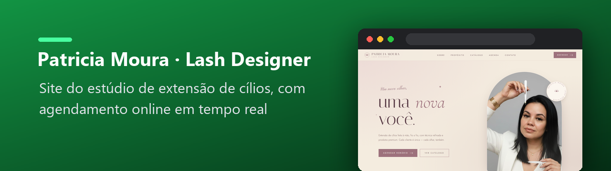
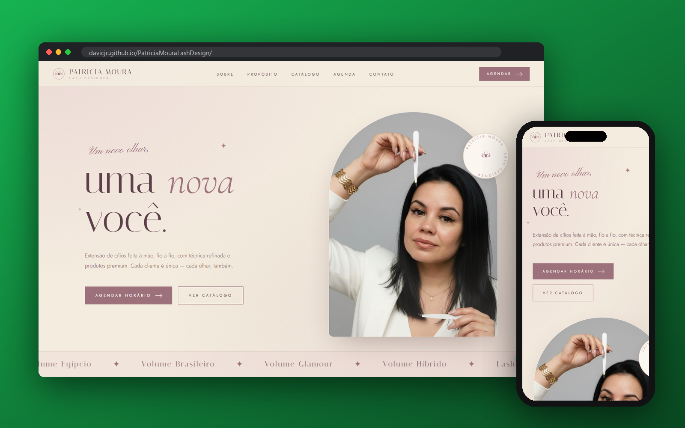
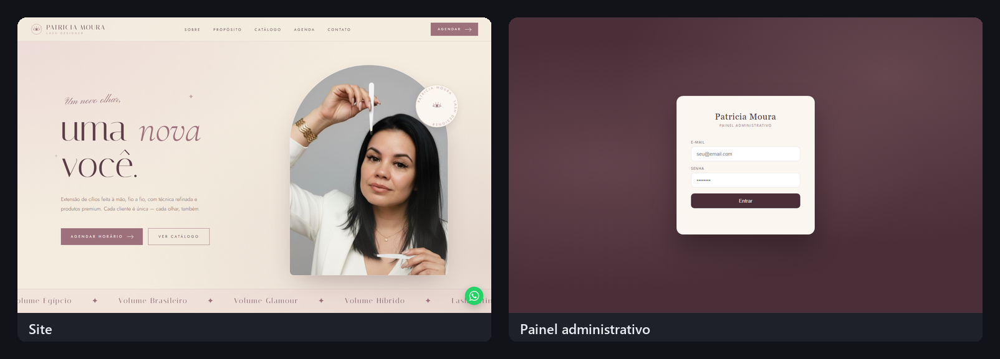

  

  
  
  
  
  
  

Site do estúdio de extensão de cílios Patricia Moura, com agendamento online em tempo real (Firebase) e painel administrativo.

  

### 📸 Telas do sistema

  

---

Site profissional com sistema de agendamento online para o estúdio de extensão de cílios da Patricia Moura.

---

## Visão geral

Landing page completa com identidade visual da marca, catálogo de serviços e agendamento em tempo real integrado ao Firebase. Clientes reservam horários diretamente pelo site; slots ocupados ficam indisponíveis instantaneamente para todos os outros usuários.

---

## Funcionalidades

### Site público (`index.html`)
- **Identidade visual** — paleta mauve + creme fiel ao branding da Patricia, tipografia refinada com Cormorant Garamond e Italiana
- **Seções completas** — Hero, Sobre, Propósito, Catálogo de serviços, Agenda, Depoimentos, Contato e Footer
- **Catálogo de serviços** — Volume Egípcio, Volume Brasileiro, Volume Glamour, Volume Híbrido e opções de manutenção com preços
- **Agendamento online em 4 passos**
  - Escolha do serviço
  - Calendário interativo (Segunda a Sábado, respeitando dias bloqueados)
  - Horários em tempo real — slots já reservados aparecem riscados e bloqueados
  - Formulário de dados com validações automáticas:
    - Nome com capitalização inteligente (preposições em minúsculo)
    - WhatsApp com máscara `(XX) XXXXX-XXXX`
    - CPF com máscara `000.000.000-00` e validação dos dígitos verificadores
- **Proteção contra dupla reserva** — transação atômica no Firestore impede que dois clientes reservem o mesmo horário simultaneamente
- **Links diretos** para WhatsApp e Instagram da Patricia
- **Botão flutuante** de WhatsApp em todas as páginas
- Design responsivo para mobile

### Painel administrativo (`admin.html`)
- **Login seguro** com e-mail e senha via Firebase Authentication
- **Dashboard com resumo** — total de agendamentos, quantidade do mês, da semana e receita estimada
- **Tabela completa** de agendamentos com filtros por nome, status, serviço e período
- **Alterar status** diretamente na tabela — Confirmado / Concluído / Cancelado / Pendente
- **Editar agendamento** — modal completo para alterar qualquer campo
- **Excluir** com confirmação
- **Novo agendamento manual** — para reservas feitas por telefone
- **Gestão de agenda**
  - Calendário visual com contagem de agendamentos por dia
  - Bloquear / desbloquear dias individualmente com motivo opcional
  - Bloquear períodos inteiros (férias, feriados) em um clique
  - Lista de dias bloqueados com opção de remover
  - Dias bloqueados ficam automaticamente indisponíveis no site público

---

## Tecnologias

| Camada | Tecnologia |
|---|---|
| Front-end | HTML, CSS, JavaScript puro |
| Hospedagem | GitHub Pages |
| Banco de dados | Firebase Firestore |
| Autenticação | Firebase Authentication |
| Fontes | Google Fonts (Cormorant Garamond, Italiana, Jost, Pinyon Script) |

Sem framework, sem servidor próprio, sem custo de infraestrutura — 100% no plano gratuito do Firebase.

---

## Crédito

Desenvolvido por **Davi Castro**.

---

Desenvolvido por <a href="https://github.com/Davicjc">Davi Castro</a> · <a href="https://davicjc.com">davicjc.com</a> para Patricia Moura

